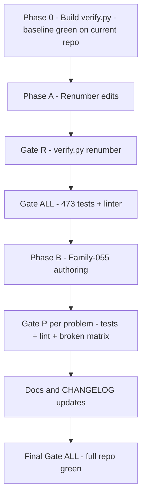

# Plan — Renumber Families to x10 and Build Family-055 Encapsulation + Inheritance

> Integration exam family: one practical exam covering SG 8 (Encapsulation) and
> SG 9 (Inheritance) for Grade 9, solvable in 10–25 minutes.
>
> **v2 — revised after review:** phases are gated by automated checks run via
> `python3 tools/verify.py` (stdlib-only, no npm — see D7). Every task carries
> feasibility/confidence estimates; anything that scored ≤90% was simplified.

---

## Decisions Log (agreed with the teacher)

| # | Decision | Choice |
|---|----------|--------|
| D1 | What the student writes | Provided parent + **ONE** child class (~10–15 min) |
| D2 | Encapsulation depth | Protected `_value` + `get_value()`; validation in `__init__` |
| D3 | Method overriding | **Excluded** — parent's `display_info()` is inherited, never overridden |
| D4 | Placement / numbering | Zero-padded 3-digit; exam family at `Family-055` |
| D5 | Zero fallback | 0 is a documented **placeholder meaning "not recorded"** |
| D6 | Historical plans | `plans/*.md` round records stay untouched; only living docs updated |
| D7 | Test runner | **No npm.** Repo is stdlib Python + bash. One entry: `python3 tools/verify.py` (subcommands below). A `package.json` wrapper is optional and discouraged — it would add a Node requirement to a Python repo (hurts DX/UX, no AX gain) |
| D8 | Reference sweep method | Done by a **one-shot script** (`tools/renumber_refs.py`, mapping-table driven, reviewable diff) — not by hand-editing ~160 files |
| D9 | Gate bar | Every phase gate must itself score ≥92% feasibility AND ≥92% confidence |

---

## How We Know the Plan Is Implemented Correctly

**Principle: the definition of done is executable.** Three gates, all
deterministic, all stdlib, all with exit codes:

| Gate | Command | Passes when |
|---|---|---|
| **Gate R** (renumber) | `python3 tools/verify.py renumber` | All 13 zero-padded folders exist, zero old-name folders remain, zero stale `Family-0N-` path refs and `Family 0N` prose refs outside the allowlist (`plans/`, `.git/`, CHANGELOG history section) |
| **Gate P** (one problem) | `python3 tools/verify.py family <problem-dir>` | (a) `python3 -m unittest tests` green against `solution.py`; (b) Example `text` block matches `python3 solution.py` output (reuses check_examples logic); (c) **broken-solution matrix**: 4 deliberately broken solutions each fail the specific test that guards their concept |
| **Gate ALL** (full repo) | `python3 tools/verify.py all` | Gate P logic for every problem folder in the repo + summary counts |

**Baseline-first rule (the key epistemic move):** before any renumber edit,
`tools/verify.py all` is built and run on the **current** repo. It must be
green (473 tests, 0 example mismatches). Any later red is then attributable to
the change under way, not to pre-existing breakage or a buggy gate. The gate
proves itself on the known-good state first.

**Why not `npm test`?** No `package.json` exists; the repo already ships
[`run_all_tests.sh`](../run_all_tests.sh) and
[`tools/check_examples.py`](../tools/check_examples.py). Both glob
`Family-*/0*/` — the family segment is wildcarded, so **both tools keep
working after renumbering unchanged** (verified finding; problem folders stay
`0X-`). `verify.py` composes them behind one AX-friendly entry point.
[`run_all_tests.sh`](../run_all_tests.sh) stays as the familiar bash wrapper.

---

## Verification Architecture



`tools/verify.py` (new, stdlib only: `unittest`, `subprocess`, `tempfile`,
`shutil`, `re`, `glob`, `sys`):

- `renumber` — structure + stale-reference audit (regex allowlist-aware)
- `family <dir>` — Gate P for one problem folder (temp-copy based; never
  mutates the real folder)
- `all` — Gate P for every `Family-*/0*/` with `tests.py` + `problem.md` +
  `solution.py`, then prints PASS/MISMATCH/FAIL summary and exits non-zero on
  any failure

`tools/renumber_refs.py` (new, one-shot, kept for the record): ordered mapping
table, path-style and prose-style rules, prints every changed file, respects
the allowlist.

---

## Task Estimates

Scores: **feasibility** = an assigned model completes it correctly in one pass;
**confidence** = we will *know* it is correct (verification strength). Raw =
before the listed simplification; final = after gate/simplification. The bar
for gates and final scores is ≥92 (D9).

### Phase 0 — Build the gates

| Task | Raw F/C | Simplification | Final F/C |
|---|---|---|---|
| T0.1 `tools/verify.py` (`renumber`, `family`, `all`) | 93/90 | Prove on current repo first (baseline must be green); keep each subcommand <80 lines | 95/**96** |
| T0.2 Broken-solution matrix inside `family` | 88/88 | Temp-copy of the folder; 4 fixed mutations (no `(Parent)`, no `super()`, public attr, `< 0` check); assert expected test failures by test id — no sys.path tricks | 94/**95** |
| T0.3 Baseline run on current repo | 98/95 | — | 98/**97** |

### Phase A — Renumber

| Task | Raw F/C | Simplification | Final F/C |
|---|---|---|---|
| A.1 `git mv` 13 folders | 99/99 | — | 99/**99** |
| A.2 Sweep refs in `Family-*` files (~160 files) | 93/**85** ← reviewed | **Scripted** (`renumber_refs.py`), not hand edits; reviewable diff; Gate R catches any residue | 97/**96** |
| A.3 Sweep root living docs (README, PROJECT_GUIDE, context.md, specs, templates, website/_docs) | 95/90 | Same script + Gate R audit; also fixes stale TV-Recorder path in 43-oop-class-spec.md | 96/**96** |
| A.4 Tool globs | 98/98 | **Not needed** (verified: globs survive renumber). Optional tidy `0*/`→`[0-9]*/`; gate = tools still run | 99/**99** |
| A.5 website `curriculum-data.js` nums/folders | 85/**80** ← reviewed | **Narrowed**: string-only edits (folder names, num fields); gate is text-level (new names present, old absent) inside Gate R — no Node dependency | 93/**93** |
| A.6 CHANGELOG: append renumber entry | 98/95 | Append-only, history untouched | 98/**96** |
| A.7 **Gate R + Gate ALL** | — | automated | 98/**97** |

### Phase B — Family-055

| Task | Raw F/C | Simplification | Final F/C |
|---|---|---|---|
| B.1 Author `01-Library-Book` (6 files) | 96/93 | Reference variant; values are pure string formatting (no arithmetic) so 06-WORKFLOW step 7 verification is trivial | 96/**96** |
| B.2 Gate P on 01 incl. broken matrix | — | automated | 97/**97** |
| B.3 Replicate `02-Video-Game-Edition`, `03-Streaming-Account`, `04-Sports-Captain` | 94/**90** ← reviewed | **Copy-01-and-substitute** with a fixed substitution table (8 fields: parent class, child class, 2 parent attrs, display label, int attr, getter name, warning message, example values); Gate P per variant catches any drift | 96/**95** |
| B.4 Gate P on 02–04 | — | automated | 97/**97** |
| B.5 Family `README.md` (20-FAMILY_TEMPLATE sections) | 98/95 | — | 98/**95** |
| B.6 Living docs + CHANGELOG append (context.md round row, README tree/table, PROJECT_GUIDE) | 95/92 | Gate R re-run covers path refs | 95/**93** |
| B.7 Final **Gate ALL** (~521 tests: 473 + 4×12) + spec checklist | — | automated | 98/**97** |

**All tasks now ≥93 feasibility and ≥95 confidence after gating.** No task
remains below the 92 bar. The three reviewed tasks (A.2, A.5, B.3) were fixed
by *moving risk from judgment to mechanism*: script the sweep, narrow the
website edits to strings, and reduce variant authoring to a substitution table
that Gate P polices.

---

## Tradeoffs: UX / DX / AX

| Axis | Choice made | Why |
|---|---|---|
| **UX** (teachers, students) | Renumber is cosmetic; exam content paths stay `Family-055-Encapsulation-Inheritance/0X-Name/`; zero new tooling requirements (stdlib only) | Teachers get a ready 15-min two-concept exam; students see one clean child class; nobody installs anything new |
| **DX** (next dev) | One canonical command (`python3 tools/verify.py all`); `run_all_tests.sh` keeps working untouched; renumber done by a reviewable one-shot script kept in `tools/` | Familiar entry points survive; the mapping table and script document the migration permanently; no Node dep |
| **AX** (next agent) | Deterministic gates with exit codes; stale-ref audit means an agent self-verifies instead of trusting its own edits; broken-solution matrix encodes *intent* executably; this plan is the spec | An agent can re-run any gate after any change and know exactly what regressed; no judgment calls needed to confirm correctness |

---

## The Unified Problem Skeleton (unchanged from v1)

Provided parent (complete, "Do NOT modify"):

```python
class Publication:
    """Represents a basic publication."""

    def __init__(self, title, author):
        self.title = title
        self.author = author

    def display_info(self):
        """Return a one-line description of the publication."""
        return f"Title: {self.title}, Author: {self.author}"
```

Student-written child — the whole exam:

```python
class Book():                                  # TODO 1: make Book inherit from Publication
    """Represents a book with a protected page count."""

    def __init__(self, title, author, number_of_pages):
        # TODO 2: call super().__init__(title, author)
        # TODO 3: if number_of_pages <= 0, print
        #         "The number of pages must be positive" and store 0
        #         (0 = placeholder meaning not recorded);
        #         otherwise store it in the PROTECTED attribute _number_of_pages
        return

    def get_number_of_pages(self):
        # TODO 4: return the protected _number_of_pages
        return 0
```

Concept boundaries: subclass line, `super()` reuse, and inherited-method use
(SG 9) + protected attribute, validate-before-store, getter-only read (SG 8).
NOT graded: overriding/chaining (SG 10), setters, exceptions, type hints.

### Broken-solution matrix (what Gate P asserts)

| Mutation | Test that must fail |
|---|---|
| `class Book():` left uninherited | test 1 + 2 (issubclass / isinstance) |
| `super().__init__` removed | tests 3–4 (title/author) |
| Public `number_of_pages` instead of `_number_of_pages` | tests 6, 9 (getter returns) |
| `< 0` instead of `<= 0` | test 7 (zero-page warning) |

## Variants (identical skeleton)

| Folder | Story | Parent (provided) | Child (student) | Validated int | Warning message |
|---|---|---|---|---|---|
| `01-Library-Book` | School library | `Publication` (title, author) | `Book` | `number_of_pages` | The number of pages must be positive |
| `02-Video-Game-Edition` | Game store | `Game` (title, genre) | `DeluxeEdition` | `bonus_levels` | The number of bonus levels must be positive |
| `03-Streaming-Account` | Streaming service | `Account` (email, owner) | `PremiumAccount` | `max_screens` | The number of screens must be positive |
| `04-Sports-Captain` | Sports club | `Member` (name, club) | `Captain` | `trophies_won` | The number of trophies must be positive |

## 12 equal-weight tests per variant

| # | Test | Concept |
|---|---|---|
| 1 | `issubclass(Book, Publication)` | Inheritance |
| 2 | `isinstance(book, Publication)` | Inheritance |
| 3 | inherits title via `super()` | Inheritance |
| 4 | inherits author via `super()` | Inheritance |
| 5 | inherited `display_info()` returns str with title+author | Inheritance |
| 6 | valid value stored, getter returns it | Encapsulation |
| 7 | zero prints warning containing "positive" (stdout-captured) | Encapsulation |
| 8 | negative prints warning | Encapsulation |
| 9 | invalid stores fallback 0 | Encapsulation |
| 10 | valid construction prints nothing | Encapsulation |
| 11 | two children independent | Integration |
| 12 | hidden: parent works standalone | Hidden |

Balance: 5 inheritance / 5 encapsulation / 1 integration / 1 hidden — neither
concept dominates the score.

## Phase A mapping (for renumber_refs.py)

Folders: `Family-01-`→`Family-010-`, `02`→`020`, `03`→`030`, `04`→`040`,
`05`→`050`, `06`→`060`, `07`→`070`, `08`→`080`, `09`→`090`, `10`→`100`,
`11`→`110`, `12`→`120`, `13`→`130`. Prose: `Family 01`→`Family 10`, ...
`Family 13`→`Family 130`. Two rules, ordered longest-number-first for path
style; allowlist: `plans/`, `.git/`, `08-CHANGELOG.md` history section.

---

## Work Order (gate at every phase boundary)

- [ ] **T0.1** Write `tools/verify.py` (`renumber`, `family`, `all`)
- [ ] **T0.2** Implement broken-solution matrix (temp-copy method)
- [ ] **T0.3** Baseline: `verify.py all` green on current repo (473 tests, 0 mismatches)
- [ ] **A.1** `git mv` 13 family folders
- [ ] **A.2** Write + run `tools/renumber_refs.py` over `Family-*` files; review diff
- [ ] **A.3** Run it over root living docs + `website/_docs` + `curriculum-data.js` string fields
- [ ] **A.5** Append CHANGELOG renumber entry
- [ ] **Gate R** `verify.py renumber` → must pass
- [ ] **Gate ALL** `verify.py all` → must pass (473 green)
- [ ] **B.1** Author `01-Library-Book` (6 deliverables, SPEC-005)
- [ ] **Gate P** `verify.py family Family-055-Encapsulation-Inheritance/01-Library-Book`
- [ ] **B.3** Substitute-table replicate 02, 03, 04
- [ ] **Gate P** ×3
- [ ] **B.5** Family `README.md`
- [ ] **B.6** Living-doc updates + CHANGELOG append
- [ ] **Final** `verify.py all` (~521 tests) + spec checklist signoff
